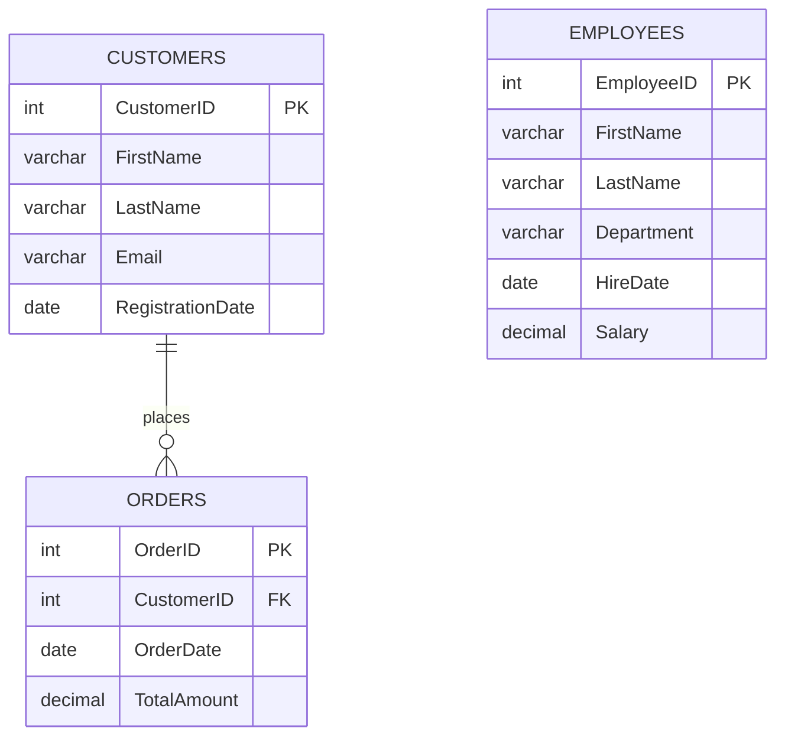

<div align="center">


<br/>


</div>

---

## 🎥 Video Demo

<!--
  HOW TO ADD YOUR VIDEO:
  1. Upload your demo video to YouTube, Google Drive, Loom, etc.
  2. Copy the video link.
  3. Replace PASTE_YOUR_VIDEO_LINK_HERE below with that link.
-->

▶️ **Watch the demo video:** [PASTE_YOUR_VIDEO_LINK_HERE](https://drive.google.com/file/d/1VQn5-6OrHFtqzUpheyTyGzDqNvBjNhu8/view?usp=sharing)

---

## 📑 Contents

1. 🎯 [Objective](#objective)
2. 🧭 [Project Overview](#project-overview)
3. 🗄️ [Database Design](#database-design)
4. 🛠️ [Setup](#setup)
5. 🧪 [The 17 Queries](#the-17-queries)
6. ▶️ [How to Run](#how-to-run)
7. 📝 [Notes](#notes)
8. ✅ [What You Will Learn](#what-you-will-learn)

---

<a id="objective"></a>
## 🎯 Objective

**Data Transformer** is a SQL project that builds practical knowledge of advanced SQL. You will work with:

- 🔗 **Joins**
- 🧩 **Subqueries**
- 📅 **Date functions**
- ✂️ **String functions**
- 🪟 **Window functions**
- 🚦 **CASE expressions**

By the end, you can transform and manipulate data for **reporting, analysis and complex queries**.

<a id="project-overview"></a>
## 🧭 Project Overview

The project simulates a small **Corporate Data Analysis System** with three parts:

| | Part | Table |
|:-:|---|---|
| 1️⃣ | Customer Information Management | `Customers` |
| 2️⃣ | Sales Transaction Processing | `Orders` |
| 3️⃣ | Employee Performance Data | `Employees` |

---

<a id="database-design"></a>
## 🗄️ Database Design

One customer can place many orders. The `Employees` table stands on its own.



### 1️⃣ Customers

| CustomerID | FirstName | LastName | Email | RegistrationDate |
|:-:|:-:|:-:|:-:|:-:|
| 1 | John | Doe | john.doe@email.com | 2022-03-15 |
| 2 | Jane | Smith | jane.smith@email.com | 2021-11-02 |

### 2️⃣ Orders

| OrderID | CustomerID | OrderDate | TotalAmount |
|:-:|:-:|:-:|:-:|
| 101 | 1 | 2023-07-01 | 150.50 |
| 102 | 2 | 2023-07-03 | 200.75 |

### 3️⃣ Employees

| EmployeeID | FirstName | LastName | Department | HireDate | Salary |
|:-:|:-:|:-:|:-:|:-:|:-:|
| 1 | Mark | Johnson | Sales | 2020-01-15 | 50000.00 |
| 2 | Susan | Lee | HR | 2021-03-20 | 55000.00 |

---

<a id="setup"></a>
## 🛠️ Setup

Run this script first. It creates the database, the three tables and the sample data. You can run it again any time.

<details>
<summary>📜 <b>Click to see the setup script</b></summary>

```sql
CREATE DATABASE IF NOT EXISTS DataTransformer;
USE DataTransformer;

DROP TABLE IF EXISTS Orders;
DROP TABLE IF EXISTS Customers;
DROP TABLE IF EXISTS Employees;

CREATE TABLE Customers (
    CustomerID       INT           PRIMARY KEY,
    FirstName        VARCHAR(50)   NOT NULL,
    LastName         VARCHAR(50)   NOT NULL,
    Email            VARCHAR(100),
    RegistrationDate DATE
);

CREATE TABLE Orders (
    OrderID     INT            PRIMARY KEY,
    CustomerID  INT,
    OrderDate   DATE,
    TotalAmount DECIMAL(10,2),
    FOREIGN KEY (CustomerID) REFERENCES Customers(CustomerID)
);

CREATE TABLE Employees (
    EmployeeID INT           PRIMARY KEY,
    FirstName  VARCHAR(50)   NOT NULL,
    LastName   VARCHAR(50)   NOT NULL,
    Department VARCHAR(50),
    HireDate   DATE,
    Salary     DECIMAL(10,2)
);

INSERT INTO Customers (CustomerID, FirstName, LastName, Email, RegistrationDate) VALUES
(1, 'John', 'Doe',   'john.doe@email.com',   '2022-03-15'),
(2, 'Jane', 'Smith', 'jane.smith@email.com', '2021-11-02');

INSERT INTO Orders (OrderID, CustomerID, OrderDate, TotalAmount) VALUES
(101, 1, '2023-07-01', 150.50),
(102, 2, '2023-07-03', 200.75);

INSERT INTO Employees (EmployeeID, FirstName, LastName, Department, HireDate, Salary) VALUES
(1, 'Mark',  'Johnson', 'Sales', '2020-01-15', 50000.00),
(2, 'Susan', 'Lee',     'HR',    '2021-03-20', 55000.00);
```

</details>

---

<a id="the-17-queries"></a>
## 🧪 The 17 Queries

Each query has the **goal**, the **SQL**, a **simple explanation** and the **expected output**.

### 🔗 Part 1: Joins

#### Q1. INNER JOIN
🎯 Get all orders with their customer details, where orders exist.

```sql
SELECT  o.OrderID, o.OrderDate, o.TotalAmount,
        c.CustomerID, c.FirstName, c.LastName, c.Email, c.RegistrationDate
FROM    Orders o
INNER JOIN Customers c
        ON o.CustomerID = c.CustomerID;
```

💡 Keeps only the rows that match in **both** tables.

<details>
<summary>📤 Expected output</summary>

| OrderID | OrderDate | TotalAmount | CustomerID | FirstName | LastName | Email | RegistrationDate |
|:-:|:-:|:-:|:-:|:-:|:-:|:-:|:-:|
| 101 | 2023-07-01 | 150.50 | 1 | John | Doe | john.doe@email.com | 2022-03-15 |
| 102 | 2023-07-03 | 200.75 | 2 | Jane | Smith | jane.smith@email.com | 2021-11-02 |

</details>

#### Q2. LEFT JOIN
🎯 Get all customers and their orders (if any).

```sql
SELECT  c.CustomerID, c.FirstName, c.LastName, c.Email, c.RegistrationDate,
        o.OrderID, o.OrderDate, o.TotalAmount
FROM    Customers c
LEFT JOIN Orders o
        ON c.CustomerID = o.CustomerID;
```

💡 Keeps **every customer**. If a customer has no order, the order columns show `NULL`.

<details>
<summary>📤 Expected output</summary>

| CustomerID | FirstName | LastName | Email | RegistrationDate | OrderID | OrderDate | TotalAmount |
|:-:|:-:|:-:|:-:|:-:|:-:|:-:|:-:|
| 1 | John | Doe | john.doe@email.com | 2022-03-15 | 101 | 2023-07-01 | 150.50 |
| 2 | Jane | Smith | jane.smith@email.com | 2021-11-02 | 102 | 2023-07-03 | 200.75 |

</details>

#### Q3. RIGHT JOIN
🎯 Get all orders and their customers (if any).

```sql
SELECT  o.OrderID, o.OrderDate, o.TotalAmount,
        c.CustomerID, c.FirstName, c.LastName, c.Email, c.RegistrationDate
FROM    Customers c
RIGHT JOIN Orders o
        ON c.CustomerID = o.CustomerID;
```

💡 Keeps **every order**. If an order has no customer, the customer columns show `NULL`.

<details>
<summary>📤 Expected output</summary>

| OrderID | OrderDate | TotalAmount | CustomerID | FirstName | LastName | Email | RegistrationDate |
|:-:|:-:|:-:|:-:|:-:|:-:|:-:|:-:|
| 101 | 2023-07-01 | 150.50 | 1 | John | Doe | john.doe@email.com | 2022-03-15 |
| 102 | 2023-07-03 | 200.75 | 2 | Jane | Smith | jane.smith@email.com | 2021-11-02 |

</details>

#### Q4. FULL OUTER JOIN
🎯 Get all customers and all orders, whether they match or not.

```sql
SELECT  c.CustomerID, c.FirstName, c.LastName, c.Email, c.RegistrationDate,
        o.OrderID, o.CustomerID AS OrderCustomerID, o.OrderDate, o.TotalAmount
FROM    Customers c
LEFT JOIN Orders o
        ON c.CustomerID = o.CustomerID

UNION

SELECT  c.CustomerID, c.FirstName, c.LastName, c.Email, c.RegistrationDate,
        o.OrderID, o.CustomerID, o.OrderDate, o.TotalAmount
FROM    Customers c
RIGHT JOIN Orders o
        ON c.CustomerID = o.CustomerID;
```

💡 MySQL has no `FULL OUTER JOIN`, so we combine a `LEFT JOIN` and a `RIGHT JOIN` with `UNION`.

<details>
<summary>📤 Expected output</summary>

| CustomerID | FirstName | LastName | Email | RegistrationDate | OrderID | OrderCustomerID | OrderDate | TotalAmount |
|:-:|:-:|:-:|:-:|:-:|:-:|:-:|:-:|:-:|
| 1 | John | Doe | john.doe@email.com | 2022-03-15 | 101 | 1 | 2023-07-01 | 150.50 |
| 2 | Jane | Smith | jane.smith@email.com | 2021-11-02 | 102 | 2 | 2023-07-03 | 200.75 |

</details>

---

### 🧩 Part 2: Subqueries

#### Q5. Customers with orders above the average amount
🎯 Find customers who placed orders worth more than the average order.

```sql
SELECT  c.CustomerID, c.FirstName, c.LastName, c.Email, c.RegistrationDate
FROM    Customers c
WHERE   c.CustomerID IN (
            SELECT  o.CustomerID
            FROM    Orders o
            WHERE   o.TotalAmount > (SELECT AVG(TotalAmount) FROM Orders)
        );
```

💡 Read it from the inside out:
1. The average order amount is **175.625**.
2. Orders above that belong to customer **2**.
3. The outer query returns customer 2.

<details>
<summary>📤 Expected output</summary>

| CustomerID | FirstName | LastName | Email | RegistrationDate |
|:-:|:-:|:-:|:-:|:-:|
| 2 | Jane | Smith | jane.smith@email.com | 2021-11-02 |

</details>

#### Q6. Employees with salary above the average
🎯 Find employees who earn more than the average salary.

```sql
SELECT  EmployeeID, FirstName, LastName, Department, HireDate, Salary
FROM    Employees
WHERE   Salary > (SELECT AVG(Salary) FROM Employees);
```

💡 The average salary is **52500**. Only Susan earns more than that.

<details>
<summary>📤 Expected output</summary>

| EmployeeID | FirstName | LastName | Department | HireDate | Salary |
|:-:|:-:|:-:|:-:|:-:|:-:|
| 2 | Susan | Lee | HR | 2021-03-20 | 55000.00 |

</details>

---

### 📅 Part 3: Date Functions

#### Q7. Extract the year and month from OrderDate

```sql
SELECT  OrderID, OrderDate,
        YEAR(OrderDate)      AS OrderYear,
        MONTH(OrderDate)     AS OrderMonth,
        MONTHNAME(OrderDate) AS OrderMonthName
FROM    Orders;
```

💡 `YEAR()` and `MONTH()` pull one part out of a date.

<details>
<summary>📤 Expected output</summary>

| OrderID | OrderDate | OrderYear | OrderMonth | OrderMonthName |
|:-:|:-:|:-:|:-:|:-:|
| 101 | 2023-07-01 | 2023 | 7 | July |
| 102 | 2023-07-03 | 2023 | 7 | July |

</details>

#### Q8. Days between the order date and today

```sql
SELECT  OrderID, OrderDate,
        CURDATE()                      AS CurrentDate,
        DATEDIFF(CURDATE(), OrderDate) AS DaysSinceOrder
FROM    Orders;
```

💡 `DATEDIFF(later, earlier)` gives the number of days between two dates. The result changes every day.

<details>
<summary>📤 Expected output (calculated on 01-Nov-2026)</summary>

| OrderID | OrderDate | CurrentDate | DaysSinceOrder |
|:-:|:-:|:-:|:-:|
| 101 | 2023-07-01 | 2026-11-01 | 1219 |
| 102 | 2023-07-03 | 2026-11-01 | 1217 |

</details>

#### Q9. Format OrderDate as `DD-MMM-YYYY`

```sql
SELECT  OrderID, OrderDate,
        DATE_FORMAT(OrderDate, '%d-%b-%Y') AS FormattedOrderDate
FROM    Orders;
```

💡 `%d` = day, `%b` = short month name, `%Y` = 4-digit year.

<details>
<summary>📤 Expected output</summary>

| OrderID | OrderDate | FormattedOrderDate |
|:-:|:-:|:-:|
| 101 | 2023-07-01 | 01-Jul-2023 |
| 102 | 2023-07-03 | 03-Jul-2023 |

</details>

---

### ✂️ Part 4: String Functions

#### Q10. Join FirstName and LastName into a full name

```sql
-- Customers
SELECT  CustomerID, CONCAT(FirstName, ' ', LastName) AS FullName
FROM    Customers;

-- Employees
SELECT  EmployeeID, CONCAT(FirstName, ' ', LastName) AS FullName
FROM    Employees;
```

💡 `CONCAT` sticks text together. The `' '` adds the space between the names.

<details>
<summary>📤 Expected output</summary>

**Customers**

| CustomerID | FullName |
|:-:|:-:|
| 1 | John Doe |
| 2 | Jane Smith |

**Employees**

| EmployeeID | FullName |
|:-:|:-:|
| 1 | Mark Johnson |
| 2 | Susan Lee |

</details>

#### Q11. Replace part of a string (`John` becomes `Jonathan`)

```sql
SELECT  CustomerID,
        FirstName                              AS OriginalFirstName,
        REPLACE(FirstName, 'John', 'Jonathan') AS NewFirstName
FROM    Customers;
```

💡 `REPLACE(text, old, new)` swaps the text. A `SELECT` only changes what you see, not the stored data.

<details>
<summary>📤 Expected output</summary>

| CustomerID | OriginalFirstName | NewFirstName |
|:-:|:-:|:-:|
| 1 | John | Jonathan |
| 2 | Jane | Jane |

</details>

#### Q12. FirstName in UPPERCASE, LastName in lowercase

```sql
-- Customers
SELECT  CustomerID, UPPER(FirstName) AS FirstNameUpper, LOWER(LastName) AS LastNameLower
FROM    Customers;

-- Employees
SELECT  EmployeeID, UPPER(FirstName) AS FirstNameUpper, LOWER(LastName) AS LastNameLower
FROM    Employees;
```

<details>
<summary>📤 Expected output</summary>

**Customers**

| CustomerID | FirstNameUpper | LastNameLower |
|:-:|:-:|:-:|
| 1 | JOHN | doe |
| 2 | JANE | smith |

**Employees**

| EmployeeID | FirstNameUpper | LastNameLower |
|:-:|:-:|:-:|
| 1 | MARK | johnson |
| 2 | SUSAN | lee |

</details>

#### Q13. Trim extra spaces from Email

```sql
SELECT  CustomerID,
        Email       AS OriginalEmail,
        TRIM(Email) AS TrimmedEmail
FROM    Customers;
```

💡 `TRIM` removes spaces at the start and end. The sample emails are already clean, so nothing visibly changes.

<details>
<summary>📤 Expected output</summary>

| CustomerID | OriginalEmail | TrimmedEmail |
|:-:|:-:|:-:|
| 1 | john.doe@email.com | john.doe@email.com |
| 2 | jane.smith@email.com | jane.smith@email.com |

</details>

---

### 🪟 Part 5: Window Functions

> 💡 A window function calculates across rows **without removing any rows** from the result.

#### Q14. Running total of TotalAmount

```sql
SELECT  OrderID, CustomerID, OrderDate, TotalAmount,
        SUM(TotalAmount) OVER (
            ORDER BY OrderDate, OrderID
            ROWS BETWEEN UNBOUNDED PRECEDING AND CURRENT ROW
        ) AS RunningTotal
FROM    Orders
ORDER BY OrderDate, OrderID;
```

💡 Each row shows the sum of its own amount plus all earlier orders.

<details>
<summary>📤 Expected output</summary>

| OrderID | CustomerID | OrderDate | TotalAmount | RunningTotal |
|:-:|:-:|:-:|:-:|:-:|
| 101 | 1 | 2023-07-01 | 150.50 | 150.50 |
| 102 | 2 | 2023-07-03 | 200.75 | 351.25 |

</details>

#### Q15. Rank orders by TotalAmount with RANK()

```sql
SELECT  OrderID, CustomerID, OrderDate, TotalAmount,
        RANK() OVER (ORDER BY TotalAmount DESC) AS AmountRank
FROM    Orders
ORDER BY AmountRank;
```

💡 The biggest amount gets rank **1**. If two orders tie, they share a rank and the next number is skipped.

<details>
<summary>📤 Expected output</summary>

| OrderID | CustomerID | OrderDate | TotalAmount | AmountRank |
|:-:|:-:|:-:|:-:|:-:|
| 102 | 2 | 2023-07-03 | 200.75 | 1 |
| 101 | 1 | 2023-07-01 | 150.50 | 2 |

</details>

---

### 🚦 Part 6: CASE Expression

#### Q16. Assign a discount based on TotalAmount
🎯 More than 1000 gets **10% off**. More than 500 gets **5% off**. Otherwise no discount.

```sql
SELECT  OrderID, CustomerID, TotalAmount,
        CASE
            WHEN TotalAmount > 1000 THEN 10
            WHEN TotalAmount > 500  THEN 5
            ELSE 0
        END AS DiscountPercent,
        ROUND(TotalAmount * CASE
                                WHEN TotalAmount > 1000 THEN 0.10
                                WHEN TotalAmount > 500  THEN 0.05
                                ELSE 0
                            END, 2) AS DiscountAmount,
        ROUND(TotalAmount * (1 - CASE
                                WHEN TotalAmount > 1000 THEN 0.10
                                WHEN TotalAmount > 500  THEN 0.05
                                ELSE 0
                            END), 2) AS FinalAmount
FROM    Orders;
```

💡 `CASE` checks the conditions **from top to bottom** and stops at the first match. That is why `> 1000` comes before `> 500`.

<details>
<summary>📤 Expected output</summary>

Both sample orders are below 500, so there is no discount.

| OrderID | CustomerID | TotalAmount | DiscountPercent | DiscountAmount | FinalAmount |
|:-:|:-:|:-:|:-:|:-:|:-:|
| 101 | 1 | 150.50 | 0 | 0.00 | 150.50 |
| 102 | 2 | 200.75 | 0 | 0.00 | 200.75 |

</details>

#### Q17. Categorize salaries as High, Medium or Low
🎯 Label each employee's salary.

> 📌 The brief does not give the limits, so I assumed: **High** = 60000 or more, **Medium** = 40000 to 59999, **Low** = below 40000. Change the numbers if you need different rules.

```sql
SELECT  EmployeeID, FirstName, LastName, Department, Salary,
        CASE
            WHEN Salary >= 60000 THEN 'High'
            WHEN Salary >= 40000 THEN 'Medium'
            ELSE 'Low'
        END AS SalaryCategory
FROM    Employees;
```

<details>
<summary>📤 Expected output</summary>

| EmployeeID | FirstName | LastName | Department | Salary | SalaryCategory |
|:-:|:-:|:-:|:-:|:-:|:-:|
| 1 | Mark | Johnson | Sales | 50000.00 | Medium |
| 2 | Susan | Lee | HR | 55000.00 | Medium |

</details>

---

<a id="how-to-run"></a>
## ▶️ How to Run

1. 📥 Install **MySQL 8.0 or newer** and **MySQL Workbench**.
2. 📂 Open Workbench, then choose **File → Open SQL Script** and select `data_transformer.sql`.
3. ⚡ Click the **lightning bolt** to run everything. Each query opens in its own result tab.
4. 🎯 To run just one query, highlight it and press **Ctrl + Enter** (**Cmd + Enter** on Mac).

Prefer the command line? Run this instead:

```bash
mysql -u root -p < data_transformer.sql
```

<a id="notes"></a>
## 📝 Notes

- 🐬 The queries are written for **MySQL 8.0+**. Window functions (Q14, Q15) need version 8 or higher.
- 🔀 **Q4:** MySQL has no `FULL OUTER JOIN`, so it is built with `LEFT JOIN` + `UNION` + `RIGHT JOIN`. On PostgreSQL or SQL Server, use `FULL OUTER JOIN` directly.
- 📆 **Q8:** the numbers depend on today's date, so yours will differ.
- 👥 **Q10 and Q12:** the brief says "FirstName and LastName" without naming a table, so both `Customers` and `Employees` are covered.
- 🔎 In the sample data every customer has an order, so LEFT, RIGHT and FULL joins give the same rows as the INNER JOIN.

<a id="what-you-will-learn"></a>
## ✅ What You Will Learn

- [x] 🔗 Combine tables with INNER, LEFT, RIGHT and FULL joins
- [x] 🧩 Write subqueries and compare values to an average
- [x] 📅 Extract, compare and format dates
- [x] ✂️ Clean and reshape text with string functions
- [x] 🪟 Build running totals and rankings with window functions
- [x] 🚦 Add if/else logic with `CASE`

---

<div align="center">

### 💙 Made with SQL and a lot of practice by


</div>
